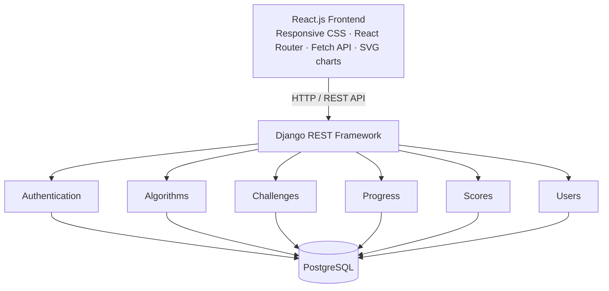
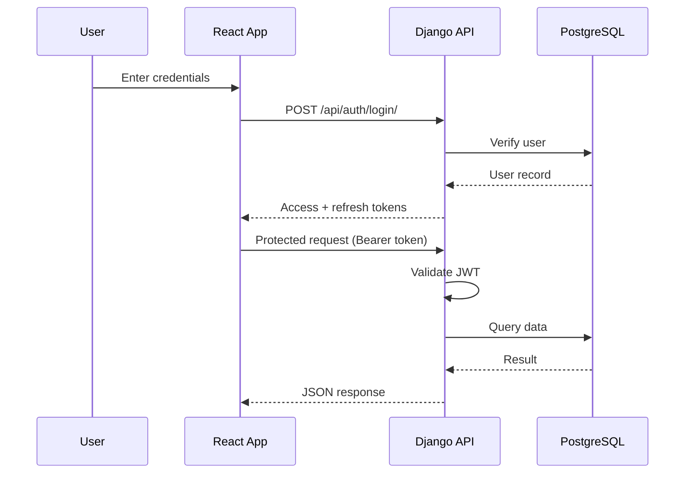

# CodeLens

**An interactive programming education platform that turns algorithm execution into a visual, step-by-step learning experience.**


---

## Table of Contents

- [Overview](#overview)
- [Key Features](#key-features)
- [Tech Stack](#tech-stack)
- [System Architecture](#system-architecture)
- [Authentication & Roles](#authentication--roles)
- [Database Design](#database-design)
- [Project Structure](#project-structure)
- [Getting Started](#getting-started)
- [API Overview](#api-overview)
- [Roadmap](#roadmap)
- [Contributing](#contributing)
- [License](#license)

---

## Overview

CodeLens is a full-stack web platform that helps students understand data structures and algorithms by *watching* them run. Instead of reading static pseudocode, learners step through each comparison, swap and traversal, then test their understanding through graded challenges and track their growth on a personal analytics dashboard.

## Team contribution: Shweta — Django Backend + PostgreSQL Developer

Shweta's primary responsibility is the server side: Django models and relationships, PostgreSQL configuration, REST APIs, authentication and permissions, progress APIs, analytics APIs, and Django Admin. She implements the persistence and API integration used by the algorithm, data-structure, challenge, submission, scoring, achievement, and user modules. Challenge design, scoring rules, and analytics product requirements are shared with Het's challenge and analytics role; Shweta owns their backend API and database integration. Students can access learning content and their own activity, while staff-only endpoints manage platform content and inspect submissions and users.

The platform combines:

- Algorithm visualization
- Data-structure manipulation
- Challenge evaluation
- Complexity analysis
- Student performance analytics

React powers the dynamic visualization UI, while Django REST Framework handles authentication, persistence, challenges, scoring and analytics.

---

## Key Features

### Algorithm Visualizer
The core feature of CodeLens. Each algorithm is broken into discrete steps that can be played, paused, stepped through and replayed.

**Playback controls:** Previous · Play · Pause · Next · Speed slider

**Supported algorithms**

| Category | Algorithms |
|----------|------------|
| Sorting | Bubble Sort, Selection Sort, Insertion Sort, Merge Sort, Quick Sort |
| Searching | Linear Search, Binary Search |
| Graph Traversal | BFS, DFS |

Example (Bubble Sort):

```
Step 1   [5] [2] [8] [1] [3]     Compare 5 and 2
Step 2   [2] [5] [8] [1] [3]     Compare 5 and 8
```

### Data Structure Visualizer
Interactive, operation-driven views of core data structures.

| Structure | Operations |
|-----------|------------|
| Stack | Push, Pop, Peek |
| Queue | Enqueue, Dequeue, Front |
| Linked List | Insert, Delete, Traverse |
| Binary Tree | Insert, Delete, Traversals |

### Code Playground
A code editor and output view with predefined Java and Python algorithm templates. The initial scope uses curated templates rather than a full online compiler.

### Test Case Runner
Run built-in cases for mixed, sorted, and repeated values. The runner reports the expected and actual output for each case.

### Complexity Analyzer
After an algorithm runs, CodeLens reports:

- Time complexity (e.g. `O(n²)`)
- Space complexity (e.g. `O(1)`)
- Number of comparisons
- Number of swaps
- Total execution steps

### Challenge Mode
Students are given a problem (for example, sorting `[9, 4, 7, 2, 6]`), choose an approach, and submit. The system evaluates correctness and compares the student's operation count against the optimal count to produce a score.

```
Result:            Correct
Your operations:   18
Optimal operations: 16
Score:             92 / 100
```

### Student Dashboard & Analytics
- Overall DSA progress
- Algorithms and challenges completed
- Daily learning streak
- Weak-area detection (e.g. Graphs, Dynamic Programming)
- Score history charts

### Admin Panel
Administrators can manage all platform content and users:

- Add and publish algorithms (explanation, visualization steps, complexity)
- Manage challenges and questions
- Manage students
- View scores and progress reports

---

## Tech Stack

| Layer | Technology | Purpose |
|-------|------------|---------|
| Frontend | React.js | UI and interactive visualizations |
| Styling | Responsive CSS design system | Modern, responsive design |
| Routing | React Router | Client-side page navigation |
| HTTP Client | Browser Fetch API | React ↔ Django communication |
| Charts | Responsive SVG | Student analytics |
| Backend | Django | Server-side application logic |
| REST API | Django REST Framework | API layer for the React client |
| Database | PostgreSQL | Users, algorithms, challenges, progress, scores |
| Authentication | JWT via SimpleJWT | Secure login with access/refresh tokens |
| Admin | Django Admin | Content and user management |

---

## System Architecture



**Design principle:** responsibilities are cleanly separated. React handles the interactive UI and visualization; Django handles business logic, authentication, and data access through REST APIs.

---

## Authentication & Roles

CodeLens uses JWT-based authentication (SimpleJWT) with role-based access control.



| Role | Access |
|------|--------|
| **Student** | Dashboard, algorithm and data-structure visualizers, challenges, progress and score tracking |
| **Admin** | Everything above, plus content management, student management, and score/progress reports |

---

## Database Design

Core Django models:

| Model | Description |
|-------|-------------|
| `User` | Student and admin accounts |
| `Algorithm` | Algorithm content, explanation, complexity, visualization metadata |
| `DataStructure` | Data-structure content and supported operations |
| `Challenge` | Challenge definitions and difficulty |
| `Question` | Individual questions belonging to challenges |
| `Submission` | A user's answer or attempt |
| `Progress` | Per-user completion tracking |
| `Score` | Evaluated results for submissions |
| `Achievement` | Badges and milestones |

```
User
 ├── Progress
 ├── Submission
 ├── Score
 └── Achievement
```

---

## Project Structure

```
codelens/
│
├── frontend/                        # React application
│   └── src/
│       ├── components/
│       │   ├── Navbar.jsx
│       │   ├── Sidebar.jsx
│       │   ├── AlgorithmCard.jsx
│       │   ├── CodeEditor.jsx
│       │   ├── Visualization.jsx
│       │   ├── StepController.jsx
│       │   ├── ComplexityCard.jsx
│       │   ├── ProgressBar.jsx
│       │   └── ChallengeCard.jsx
│       ├── pages/
│       │   ├── Dashboard.jsx
│       │   ├── Playground.jsx
│       │   ├── Algorithms.jsx
│       │   ├── Visualizer.jsx
│       │   ├── DataStructures.jsx
│       │   ├── Challenges.jsx
│       │   ├── Analytics.jsx
│       │   └── Login.jsx
│       ├── algorithms/              # Step generators for each algorithm
│       │   ├── bubbleSort.js
│       │   ├── selectionSort.js
│       │   ├── insertionSort.js
│       │   ├── mergeSort.js
│       │   └── quickSort.js
│       ├── services/
│       │   ├── api.js               # Fetch-based API calls and JWT handling
│       │   ├── challenges.js
│       │   └── analytics.js
│       ├── context/
│       │   └── AuthContext.jsx
│       └── App.jsx
│
└── backend/                         # Django project
    ├── manage.py
    ├── config/
    │   ├── settings.py
    │   ├── urls.py
    │   └── wsgi.py
    ├── users/
    ├── algorithms/
    ├── challenges/
    └── progress/                    # Each app: models, serializers, views, urls
```

---

## Getting Started

### Prerequisites

- Node.js 20+ and npm
- Python 3.10+
- PostgreSQL 14+

### 1. Clone the repository

```bash
git clone https://github.com/<your-username>/codelens.git
cd codelens
```

### 2. Backend setup

```bash
cd backend
python -m venv venv
source venv/bin/activate          # Windows: venv\Scripts\activate
pip install -r requirements.txt
```

Create a PostgreSQL database, then copy `.env.example` to `.env` in the repository root and set your local database password and Django secret key:

```
DB_NAME=codelens_db
DB_USER=postgres
DB_PASSWORD=your_password
DB_HOST=localhost
DB_PORT=5432
```

Run migrations and start the server:

```bash
python manage.py migrate
python manage.py createsuperuser
python manage.py runserver
```

The API is now available at `http://localhost:8000`.

### 3. Frontend setup

```bash
cd frontend
npm install
npm run dev
```

The app is now available at `http://localhost:5173` (Vite).

---

## API Overview

Authentication endpoints are implemented under `/api/auth/`. Registration creates a student account; admins are assigned through Django's `is_staff` permission rather than public registration.

| Method | Endpoint | Description | Access |
|--------|----------|-------------|--------|
| POST | `/api/auth/register/` | Register a new student | Public |
| POST | `/api/auth/login/` | Obtain JWT access/refresh tokens | Public |
| POST | `/api/auth/logout/` | Revoke the submitted refresh token | Refresh token |
| POST | `/api/auth/token/refresh/` | Refresh access token | Refresh token |
| GET | `/api/auth/profile/` | Get the signed-in user's profile and role | Authenticated |
| GET | `/api/auth/users/` | List accounts for the admin panel | Admin |
| GET | `/api/algorithms/` | List algorithms | Authenticated |
| GET | `/api/algorithms/{id}/` | Algorithm details and steps | Authenticated |
| GET | `/api/data-structures/` | List data-structure guides | Authenticated |
| GET | `/api/challenges/` | List challenges | Authenticated |
| POST | `/api/challenges/{id}/submit/` | Submit a challenge attempt | Student |
| GET | `/api/progress/` | Current user's progress | Student |
| GET | `/api/progress/summary/` | Current user's completion, score, and streak summary | Student |
| GET | `/api/progress/leaderboard/` | Score rankings (`?period=weekly` for seven days) | Authenticated |
| GET | `/api/analytics/` | Current user's activity and performance metrics | Student |
| GET | `/api/achievements/` | Achievement catalog and current user's unlocks | Authenticated |
| GET | `/api/scores/` | Current user's scores | Student |
| POST | `/api/algorithms/` | Create an algorithm | Admin |
| POST | `/api/data-structures/` | Create data-structure content | Admin |
| POST | `/api/challenges/` | Create a challenge | Admin |

Send the access token with protected API requests using `Authorization: Bearer <access-token>`. The frontend keeps tokens in session storage and clears them on sign-out.

---

## Roadmap

- [x] Project setup (React + Django + PostgreSQL configuration)
- [x] JWT authentication with role-based access
- [x] Sorting visualizer (Bubble, Selection, Insertion)
- [x] Merge Sort, Quick Sort and Binary Search visualizers
- [x] BFS and DFS graph visualizers
- [x] Data-structure visualizers (Stack, Queue, Linked List, Doubly Linked List, Binary Search Tree)
- [x] Complexity analyzer
- [x] Challenge mode with server-side scoring and pseudocode checks
- [x] Student dashboard and analytics
- [x] Admin content management
- [x] Code playground with Java/Python starter templates and built-in test cases
- [x] Achievements and streak system

The playground uses curated starter code and runs CodeLens's built-in Bubble Sort implementation; it does not execute arbitrary submitted source code.


